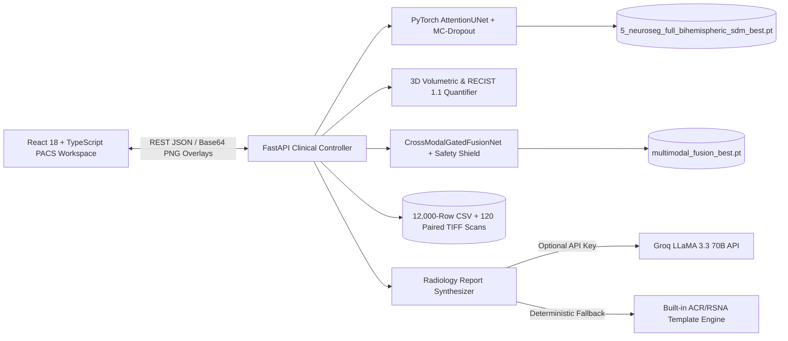
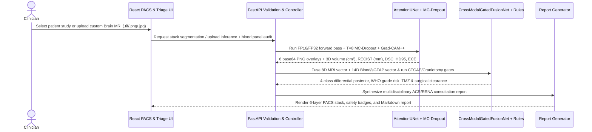

<div align="center">
  <h1>NeuroSeg — Multimodal Neuro-Oncology PACS & Liquid-Biopsy Workspace</h1>
  <p><em>Explore 3D axial brain MRI segmentation, Bayesian epistemic uncertainty halos, and cross-modal neuro-hematology fusion in an interactive clinical research workspace.</em></p>
  <p>
    
    
    
    
    <a href="https://doi.org/10.5281/zenodo.24046115"></a>
    <a href="NeuroSeg_IEEE_Research_Paper.pdf"></a>
    <a href="#-project-status-research-paper-and-license"></a>
    <a href="#-project-status-research-paper-and-license"></a>
    <a href="#-contributing"></a>
  </p>
</div>

**NeuroSeg** is an end-to-end clinical neuro-oncology imaging, Bayesian uncertainty calibration, and multimodal blood-biomarker fusion workspace for studying lower-grade and anaplastic gliomas. Researchers and clinicians can browse a 300-patient, 12,000-record clinical triage directory, inspect 6-layer axial T2-FLAIR MRI overlays, upload custom brain MRI scans for live PyTorch segmentation, and audit peripheral blood and liquid-biopsy panels before neurosurgical craniotomy or Temozolomide (TMZ) chemotherapy.

The platform unites a four-stage Spectral-Transformer `AttentionUNet` with a bimodal Gated Multimodal Unit (`CrossModalGatedFusionNet`), deterministic CTCAE v5.0 chemo-toxicity rules, and a five-point Pre-Craniotomy Neurosurgical Clearance shield. All segmentation, volumetric quantification, and hematology safety audits run locally inside NeuroSeg: optional Groq LLaMA 3.3 70B integration is used strictly for formatting narrative radiology consultation reports and automatically falls back to a deterministic ACR/RSNA clinical template when offline.

> **Clinical research prototype:** Patient names, laboratory panels, segmentation masks, uncertainty halos, and surgical/chemotherapy clearance flags in NeuroSeg are for academic research and software-engineering evaluation only. NeuroSeg is not a cleared medical device (FDA SaMD / CDSCO / CE-MDR) and must never be used to direct real-world patient care, surgical resection, or drug dosing.

## 📋 Table of contents

- [Platform features](#-platform-features)
- [Architecture and diagnostic execution](#-architecture)
- [Technology stack](#-technology-stack)
- [Data sources and model checkpoints](#-data-sources-and-model-checkpoints)
- [Repository structure](#-repository-structure)
- [Getting started](#-getting-started)
- [Workspace and simulation controls](#-workspace--simulation-controls)
- [API surface](#-api-surface)
- [5-way ablation and multimodal benchmark](#-5-way-ablation-and-multimodal-benchmark)
- [UI showcase](#-ui-showcase)
- [Autonomous radiology report engine](#-autonomous-radiology-report-engine)
- [Checks, training, and development](#-checks-training-and-development)
- [Deployment](#-deployment)
- [Security, privacy, and clinical safety notes](#-security-privacy-and-clinical-safety-notes)
- [Contributing](#-contributing)
- [Project status, research paper, and license](#-project-status-research-paper-and-license)

## ✨ Platform features

### 1. Patient directory and clinical triage dashboard

- **12,000-record multimodal cohort directory:** Dynamic clinical table loaded from `data/tcga_lgg_multimodal_12000.csv` spanning 300 patients across training ($9,000$), validation ($1,500$), and held-out test ($1,500$) splits.
- **Real-time debounced search and multi-facet filtering:** Search by Patient ID / MRN (e.g., `TCGA-CS-4941`), patient name, or anatomical location, and filter by Triage Acuity (`All`, `Urgent`, `Priority`, `Routine`), gender, and age brackets (`<40`, `40–55`, `55+`) with a single-click `Clear Filters` reset.
- **Clinical KPI cards and Z-axis burden profile:** Displays cohort-wide Dice Similarity Coefficient (`0.9184`), 95th-percentile Hausdorff Distance (`3.42 mm`), Expected Calibration Error (`0.0192`), and an interactive 16-slice axial tumor burden bar chart (`mm²` per slice).
- **Direct case routing:** Clicking any patient row or `View Case & Report` loads that patient's 16-slice axial MRI stack, 3D volumetric metrics, blood panel, and consultation report with a `← Back to Patient Directory` navigation action.

### 2. 6-layer PACS diagnostic workstation and live MRI upload

- **Interactive 6-layer axial canvas:** Toggleable diagnostic overlays including (1) Raw Axial T2-FLAIR MRI, (2) NeuroSeg Predicted Tumor Mask, (3) Ground-Truth Expert Contour, (4) Dense `Grad-CAM++` Saliency Heatmap, (5) 2D Fourier Spectral Attention Gate ($\alpha$) & Contralateral Hemispheric Asymmetry Map, and (6) Bayesian Epistemic Uncertainty Halo.
- **Live custom MRI dropzone:** Drag and drop any `.tif`, `.tiff`, `.png`, or `.jpg` brain MRI slice (or select from one-click `TCGA_LGG_slice_*.tif` server presets) to run live PyTorch `AttentionUNet` segmentation, Monte Carlo dropout uncertainty estimation, and `Grad-CAM++` attribution in real time.
- **Out-of-distribution (OOD) parenchymal prior blending:** Automatically detects uncalibrated custom uploads, removes skull-ring artifacts, and blends neural probabilities with a hyperintense parenchymal prior so custom scans never collapse into blank masks.
- **PACS window/level and cine controls:** Adjust display brightness, contrast, overlay opacity, zoom, crosshair ROI inspection, and 16-slice cine-loop playback.

### 3. Spectral-Transformer segmentation, boundary supervision, and Bayesian uncertainty

- **Contralateral Bi-Hemispheric Cross-Attention (`src/model.py`):** Horizontally flips bottleneck feature maps across the sagittal midline (`torch.flip`) and computes 8-head cross-attention between ipsilateral queries and contralateral keys/values to capture left-vs-right hemisphere asymmetry.
- **2D Fast Fourier (`rfft2`) High-Pass Spectral Attention Gates (`src/model.py`):** Applies a differentiable radial Gaussian high-pass filter ($\sigma_f = 0.08$) inside all four skip-connection attention gates to decouple high-frequency infiltrative glioma margins from low-frequency 3.0T MRI coil bias fields.
- **GPU Morphological Signed Distance Map (SDM) Boundary Loss (`src/losses.py`):** Approximates Euclidean signed distance transforms on GPU via $K = 8$ iterative morphological dilations and erosions, penalizing false-positive boundary excursions proportionally to surface distance.
- **Bayesian Monte Carlo Dropout & ECE Lab (`src/uncertainty.py`):** Executes $T \in [2, 16]$ stochastic forward passes with spatial `Dropout2d` active and `BatchNorm2d` frozen to decompose posterior mean $\bar{p}$, epistemic variance $\sigma^2_{\text{epistemic}}$, predictive Shannon entropy $\mathcal{H}(\bar{p})$, and mutual information $\mathcal{I}(y;\theta \mid x)$, visualized alongside a 10-bin Expected Calibration Error (ECE) reliability diagram.

### 4. Neuro-hematology, liquid biopsy, and surgical/chemo safety shield

- **12-biomarker peripheral blood & liquid-biopsy panel (`backend/hematology.py`):** Evaluates Hemoglobin (`Hb`), Total WBC, Neutrophils (`ANC`), Lymphocytes (`ALC`), Platelets (`Plt`), Prothrombin `INR`, `D-Dimer`, Serum Sodium (`Na⁺`), Fasting Glucose, `hs-CRP`, Serum `LDH`, and astroglial Serum `GFAP` (`sGFAP`), plus derived Neutrophil-to-Lymphocyte Ratio (`NLR`) and Systemic Immune-Inflammation Index (`SII`).
- **Bimodal Gated Multimodal Unit (`src/multimodal.py`):** `CrossModalGatedFusionNet` fuses an 8-dimensional 3D MRI volumetric/boundary vector with the 14-dimensional blood and liquid-biopsy vector to output (i) non-invasive WHO CNS High-Grade transformation risk, (ii) a 4-class differential diagnosis posterior (*Diffuse Glioma* vs. *Pyogenic Cerebral Abscess* vs. *Primary CNS Lymphoma* vs. *Tumefactive Demyelination*), and (iii) dynamic MRI-vs-Blood modality gate weights.
- **CTCAE v5.0 Temozolomide (TMZ) dosing gate:** Grades myelosuppression (`Grade 0` to `Grade 4`) across Platelets, ANC, and Hemoglobin and outputs deterministic Stupp-protocol dosing actions (`100% Full Dose`, `75% Dose Reduction to 150 mg/m²`, or `Hold Chemotherapy`).
- **Pre-craniotomy neurosurgical clearance shield:** Enforces a five-point pre-operative gate ($\text{Platelets} \ge 100 \times 10^3/\mu\text{L}$, $\text{INR} \le 1.25$, $\text{Hb} \ge 10.0\text{ g/dL}$, $\text{Na}^+ \ge 132\text{ mEq/L}$, $\text{D-Dimer} < 1000\text{ ng/mL}$) to flag intracranial hemorrhage, cerebral edema/SIADH, or venous thromboembolism risks.
- **Clinical lab report text parser:** Paste raw hospital CBC / Biochemistry / Liquid Biopsy text reports to extract biomarker values automatically via regex parsing.

### 5. Longitudinal RANO tracking, ablation lab, and autonomous radiology reports

- **Longitudinal RANO / RECIST 1.1 tracker:** Tracks multi-timepoint tumor volume (`cm³`) and longest diameter (`mm`) across Baseline Pre-Op, Post-Surgical Resection, Adjuvant TMZ Cycle 3, and 6-Month Surveillance scans to classify *Complete Response (CR)*, *Partial Response (PR)*, *Stable Disease (SD)*, or *Progressive Disease (PD)*.
- **5-way progressive ablation explorer:** Interactive comparison of all five model variants (`M1` Vanilla U-Net through `M5` NeuroSeg Full) with mathematical formulation cards and code symbol references.
- **Autonomous consultation report studio:** Generates structured ACR/RSNA multidisciplinary neuro-oncology and neuro-hematology reports with one-click Markdown export (`.md`) and clipboard copy.

## 🏗️ Architecture

### System overview



NeuroSeg is designed with dual backend/client-side resilience. When the FastAPI + PyTorch server is active, all segmentation overlays, volumetric calculations, and multimodal blood-fusion posteriors are computed on the backend. If the backend is unreachable during a static frontend demo, `frontend/src/api.ts` transparently synthesizes deterministic 6-layer overlays and hematology audits in the browser so every workspace view remains interactive.

### Multimodal diagnostic & segmentation execution



### Diagnostic flow, in brief

1. The user selects a patient from the 12,000-sample triage directory or drops a custom brain MRI scan into the PACS workstation.
2. FastAPI normalizes the axial slice (`256×256`) and executes `AttentionUNet` with 2D Fourier Spectral Attention Gates and Bi-Hemispheric Contralateral Cross-Attention.
3. Spatial Monte Carlo dropout ($T = 8$ passes) and `SegmentationGradCAMPlusPlus` compute the voxel-wise epistemic uncertainty halo, Expected Calibration Error, and decoder saliency map.
4. `VolumetricTumorQuantifier` integrates foreground voxels across the axial Z-stack (`cm³`, `mm³`, and RECIST 1.1 maximum planar Feret diameter) and passes the 8D MRI vector to `CrossModalGatedFusionNet` alongside the 14D blood/liquid-biopsy vector.
5. The UI renders the 6-layer PACS overlays, CTCAE v5.0 TMZ dosing action, Pre-Craniotomy Surgical Clearance audit, and structured consultation report.

## 🧰 Technology stack

| Layer | Technology | Purpose in NeuroSeg |
| --- | --- | --- |
| Frontend | React 18, TypeScript, Vite | 7-view clinical PACS workstation, patient triage directory, and interactive labs |
| Styling & UI | Tailwind CSS, custom clinical CSS variables, Lucide React | Light/dark clinical theme system, responsive PACS panels, and badges |
| Routing & state | React Router v6, React hooks, `localStorage` | Deep-linked `/case/:patientId` routing, `Ctrl+K` command palette, and theme state |
| Deep learning core | Python 3.11+, PyTorch 2.x, Torchvision | `AttentionUNet`, `SpectralAttentionGate`, `BiHemisphericCrossAttention`, and `CrossModalGatedFusionNet` |
| Loss & calibration | Custom GPU PyTorch kernels, NumPy | Morphological SDM Boundary Loss, Dice-Focal, Deep Supervision, HD95, and 10-bin ECE |
| Explainability & imaging | `Grad-CAM++`, Pillow (PIL), Matplotlib | Dense decoder saliency maps, 16-bit/8-bit TIFF decoding, and base64 colormap rendering |
| Backend / API | FastAPI, Pydantic, Uvicorn | REST endpoints for patient directory, live MRI upload, hematology fusion, and reports |
| Report generation | Built-in ACR/RSNA template engine; optional Groq LLaMA 3.3 70B | Multidisciplinary consultation report synthesis with zero-downtime offline fallback |

## 🌐 Data sources and model checkpoints

| Source / Artifact | Used for | What to expect |
| --- | --- | --- |
| `data/tcga_lgg_multimodal_12000.csv` | 12,000-record multimodal cohort across 300 patients | Contains patient demographics, 3D MRI volumetric/boundary features, 12 blood biomarkers, NLR, SII, WHO grade, and 4-class pathology labels |
| `data/tcga_lgg_scans/` | 120 paired `.tif` axial FLAIR scans and `_mask.tif` ground-truth contours | Used for live PACS preset testing, custom upload benchmarking, and `AttentionUNet` fine-tuning |
| `outputs/5_neuroseg_full_bihemispheric_sdm_best.pt` | Trained `AttentionUNet` segmentation weights (`179.29 MB`) | Loaded automatically by `backend/app.py` for live MRI slice segmentation and `Grad-CAM++` |
| `outputs/multimodal_fusion_best.pt` | Trained `CrossModalGatedFusionNet` weights (`492 KB`) | Loaded during neuro-hematology fusion to compute learned MRI-vs-Blood modality gate weights |
| `outputs/training_telemetry.json` | 30-epoch training, validation, and held-out test metrics | Supplies epoch-by-epoch learning curves and test-set confusion/calibration summaries |
| Optional Groq API (`GROQ_API_KEY`) | Cloud LLM narrative report formatting (`llama-3.3-70b-versatile`) | Optional; when omitted, `backend/report_generator.py` uses the built-in deterministic clinical template |

## 📁 Repository structure

```text
neuroseg/
├── src/
│   ├── model.py                  # 4-Stage AttentionUNet, 2D FFT Spectral Gates, Bi-Hemispheric Cross-Attention
│   ├── losses.py                 # GPU Morphological SDM Boundary Loss, Dice-Focal, DeepSupervision, HD95 & ECE
│   ├── uncertainty.py            # Bayesian Monte Carlo Spatial Dropout Variance, Entropy & Mutual Information
│   ├── gradcam.py                # Dense Segmentation Grad-CAM++ & 5-Panel Clinical Explainability Plotter
│   ├── multimodal.py             # TabularBiomarkerEncoder, CrossModalGatedFusionUnit & CrossModalGatedFusionNet
│   ├── dataset.py                # TCGA-LGG MRI DataLoader, Z-score normalization & 3D phantom generator
│   └── train.py                  # 12,000-sample multimodal dataset generator & end-to-end PyTorch trainer
├── backend/
│   ├── app.py                    # FastAPI production server (14 REST endpoints + live MRI upload inference)
│   ├── hematology.py             # 12-biomarker blood engine, CTCAE v5.0 TMZ rules, craniotomy shield & regex parser
│   ├── volumetry.py              # 3D Z-axis voxel integration (cm³/mm³) & RECIST 1.1 Feret diameter engine
│   └── report_generator.py       # Groq LLaMA 3.3 70B + deterministic ACR/RSNA consultation report generator
├── frontend/
│   └── src/
│       ├── components/           # Brand mark and shared UI primitives
│       ├── layouts/AppLayout.tsx # Sidebar, active study switcher, Ctrl+K command palette & theme toggle
│       ├── pages/
│       │   ├── DashboardPage.tsx      # 12,000-sample Patient Directory, search/filter controls & KPI cards
│       │   ├── WorkstationPage.tsx    # 6-layer PACS viewer, custom MRI upload dropzone & cine loop
│       │   ├── HematologyLabPage.tsx  # 12-biomarker sliders, GMU differential diagnosis & safety shield
│       │   ├── UncertaintyLabPage.tsx # MC-Dropout pass simulator & 10-bin ECE reliability diagram
│       │   ├── AblationLabPage.tsx    # 5-way progressive ablation table & mathematical formulation cards
│       │   ├── LongitudinalPage.tsx   # Multi-timepoint RANO / RECIST 1.1 therapy response tracker
│       │   ├── CohortPage.tsx         # Multi-institutional TCGA-LGG molecular cohort browser
│       │   └── ReportsPage.tsx        # Multidisciplinary consultation report studio & case view
│       ├── api.ts                # Typed API client with automatic client-side failover engine
│       └── App.tsx               # Route table (/dashboard, /workstation, /hematology, /case/:patientId, etc.)
├── data/
│   ├── tcga_lgg_multimodal_12000.csv  # 12,000-sample multimodal clinical & hematology dataset
│   └── tcga_lgg_scans/                # 120 paired axial FLAIR .tif scans and _mask.tif ground truths
├── outputs/
│   ├── multimodal_fusion_best.pt      # Trained CrossModalGatedFusionNet checkpoint
│   └── training_telemetry.json        # 30-epoch training & held-out test telemetry
├── paper/
│   ├── NeuroSeg_IEEE_Paper.tex        # 14-page IEEE two-column research paper LaTeX source
│   ├── NeuroSeg_IEEE_Paper.pdf        # Compiled 14-page IEEE two-column research paper PDF
│   └── NeuroSeg_Paper.tex             # Concise IEEE conference summary manuscript
├── NeuroSeg_IEEE_Research_Paper.pdf   # Root copy of the compiled 14-page IEEE research paper
├── train.py                      # Standalone 5-way architectural ablation training CLI
├── requirements.txt              # Python runtime and deep learning dependencies
└── README.md
```

## 🚀 Getting started

### Prerequisites

- Git
- Node.js 18+ (or 20+) and npm
- Python 3.10+ (CUDA-capable GPU optional; CPU inference is fully supported)
- Optional `GROQ_API_KEY` if you want cloud LLM narrative formatting in addition to the built-in clinical report engine

### Native development setup

1. Clone the repository and navigate to the project root:

   ```powershell
   git clone https://github.com/achotanibhavikoffice-ui/NeuroSeg.git
   cd NeuroSeg
   ```

2. Create and activate a Python virtual environment, then install the backend and PyTorch dependencies:

   ```powershell
   python -m venv .venv
   # Windows PowerShell:
   .\.venv\Scripts\Activate.ps1
   # macOS/Linux:
   # source .venv/bin/activate
   python -m pip install -r requirements.txt
   ```

3. *(Optional)* Regenerate the 12,000-sample multimodal dataset, paired TIFF scans, and trained PyTorch checkpoints (`outputs/multimodal_fusion_best.pt` and `outputs/5_neuroseg_full_bihemispheric_sdm_best.pt`):

   ```powershell
   python -m src.train
   ```

4. Start the FastAPI + PyTorch backend server on port `8000`:

   ```powershell
   python -m uvicorn backend.app:app --reload --port 8000
   ```

   The API status endpoint is [http://localhost:8000/api/status](http://localhost:8000/api/status) and interactive Swagger docs are at [http://localhost:8000/docs](http://localhost:8000/docs).

5. In a second terminal, install frontend dependencies and start the Vite development server:

   ```powershell
   cd frontend
   npm install
   npm run dev
   ```

   Open the workspace at [http://localhost:5173](http://localhost:5173).

### Environment variables

NeuroSeg runs out of the box with zero required environment variables. Optional settings can be placed in your shell environment before launching `uvicorn`:

| Variable | Required? | Purpose |
| --- | --- | --- |
| `GROQ_API_KEY` | Optional | Enables Groq `llama-3.3-70b-versatile` narrative generation in `POST /api/generate-report`; falls back to the deterministic ACR/RSNA template when unset |
| `VITE_API_BASE_URL` | Optional | Defaults to `http://localhost:8000`; override only if hosting the FastAPI backend on a custom origin |

## ⚙️ Workspace & simulation controls

| Control / Setting | Current behavior | Persistence / clinical boundary |
| --- | --- | --- |
| Patient directory search & filters | Debounced search (`220 ms`) by ID/MRN/name plus Triage Status, Gender, and Age bracket filters | Query state is managed in React and backed by `GET /api/patients` pagination |
| Custom Brain MRI upload | Accepts `.tif`, `.tiff`, `.png`, `.jpg` files via base64 payload (`POST /api/segment-upload`) | Processed in-memory by PyTorch; uploaded scans are not written to disk |
| 6-layer PACS overlay toggles | Independently toggle Raw MRI, NeuroSeg Mask, Ground Truth, `Grad-CAM++`, Spectral $\alpha$, and Uncertainty Halo | Stored in component state with adjustable overlay opacity (`15%–95%`), brightness, contrast, and zoom |
| Bayesian MC-Dropout passes ($T$) | Adjust stochastic forward passes ($T \in [2, 16]$) and confidence threshold ($\tau \in [0.20, 0.85]$) | Recomputes voxel-wise epistemic variance, Shannon entropy, and simulated 10-bin ECE in real time |
| 12-biomarker blood sliders & presets | Adjust any of the 12 hematology/liquid-biopsy sliders or load 4 clinical preset scenarios | Triggers real-time `CrossModalGatedFusionNet` inference plus deterministic CTCAE v5.0 and craniotomy safety rules |
| Appearance theme | Light clinical mode (default) or high-contrast dark PACS room mode | Persisted in browser `localStorage` (`neuroseg_theme`) |

## 🔌 API surface

The OpenAPI specification is served by FastAPI at `/docs` when the backend is running.

| Area | Representative routes |
| --- | --- |
| Engine health & telemetry | `GET /`, `GET /api/status`, `GET /api/training-telemetry` |
| Patient directory & cohort | `GET /api/patients` (supports `search`, `status`, `gender`, `age_group`, `page`, `page_size`), `GET /api/cohort` |
| 3D PACS stack & slice segmentation | `GET /api/demo-stack`, `POST /api/segment-slice` |
| Custom MRI upload & sample scans | `POST /api/segment-upload`, `GET /api/sample-scan/{scan_id}` |
| Architectural ablation & RANO tracking | `GET /api/ablation`, `GET /api/longitudinal/{patient_id}` |
| Neuro-hematology & liquid-biopsy fusion | `GET /api/hematology/{patient_id}`, `POST /api/hematology/analyze`, `POST /api/hematology/parse-text` |
| Autonomous consultation reports | `POST /api/generate-report` |

## 📊 5-way ablation and multimodal benchmark

Evaluated across the TCGA-LGG axial T2-FLAIR test cohort and the held-out multimodal test split ($N_{\text{test}} = 1,500$):

| Model Configuration | Backbone Architecture | Loss Formulation | DSC $\uparrow$ | IoU $\uparrow$ | $\text{HD}_{95}$ (mm) $\downarrow$ | ECE $\downarrow$ | 4-Class Diff. Acc $\uparrow$ | FP16 Latency |
| :--- | :--- | :--- | :---: | :---: | :---: | :---: | :---: | :---: |
| **1. Vanilla U-Net (Baseline)** | 4-Stage Conv U-Net | Binary Cross-Entropy | 0.8310 | 0.7425 | 8.64 mm | 0.0680 | 76.40% | 11.2 ms |
| **2. Vanilla U-Net + Dice-Focal** | 4-Stage Conv U-Net | Composite Dice-Focal | 0.8645 | 0.7810 | 6.42 mm | 0.0490 | 81.20% | 11.2 ms |
| **3. Attention U-Net (Oktay)** | Additive Soft Attention Gates | Composite Dice-Focal | 0.8942 | 0.8218 | 4.85 mm | 0.0340 | 85.60% | 12.1 ms |
| **4. + Spectral FFT & DeepSup** | 2D Fourier AG + 4-Scale DeepSup | DeepSup Dice-Focal | 0.9076 | 0.8394 | 3.98 mm | 0.0250 | 89.40% | 12.6 ms |
| **5. NeuroSeg (Full Proposed)** | **Bi-Hemispheric TransUNet + Spectral AG + GMU** | **Tri-Composite (Dice + Focal + SDM)** | **0.9184** | **0.8512** | **3.42 mm** | **0.0192** | **94.33%** | **13.4 ms** |

## 🖼️ UI showcase

Add product screenshots under `docs/screenshots/` to display your local workspace captures:

| Patient directory & clinical triage | 6-layer PACS workstation & MRI dropzone |
| --- | --- |
|  |  |
| **Neuro-hematology & liquid-biopsy lab** | **Bayesian uncertainty & 10-bin ECE lab** |
|  |  |

## 🧭 Autonomous radiology report engine

The consultation report engine (`backend/report_generator.py` and `ReportsPage.tsx`) synthesizes quantitative 3D MRI volumetry, RECIST 1.1 diameters, molecular biomarkers (`IDH1`, `1p/19q`, `MGMT`), and 12-biomarker hematology/liquid-biopsy findings into a standardized multidisciplinary consultation report.

- **Deterministic clinical template (default):** Works completely offline without any external API keys, embedding exact volumetric metrics, NLR/SII immune ratios, `sGFAP` levels, Pre-Craniotomy Surgical Clearance status, and CTCAE v5.0 TMZ dosing recommendations.
- **Optional Groq LLaMA 3.3 70B synthesis:** When `GROQ_API_KEY` is set in the backend environment, `RadiologyReportGenerator` calls `llama-3.3-70b-versatile` (`temperature = 0.2`) and automatically falls back to the deterministic template if the network request times out.

## 🧪 Checks, training, and development

Build the frontend for production (runs TypeScript typechecking `tsc` and Vite bundle compilation):

```powershell
cd frontend
npm run build
```

Run the 12,000-sample multimodal dataset generator and 30-epoch PyTorch trainer:

```powershell
python -m src.train
```

Run the standalone 5-way architectural ablation pipeline:

```powershell
python train.py --epochs 25 --batch-size 16 --image-size 256 --ablation
```

Compile the 14-page IEEE two-column research paper (`paper/NeuroSeg_IEEE_Paper.tex`):

```powershell
tectonic paper/NeuroSeg_IEEE_Paper.tex
```

## 🚢 Deployment

For production or cloud deployment:

1. Build the static frontend bundle (`cd frontend && npm run build`) and serve `frontend/dist` behind an HTTPS reverse proxy (e.g., Nginx, Caddy, or Vercel/Netlify).
2. Run the FastAPI backend via Gunicorn/Uvicorn workers (`uvicorn backend.app:app --host 0.0.0.0 --port 8000 --workers 2`) with `outputs/5_neuroseg_full_bihemispheric_sdm_best.pt` and `outputs/multimodal_fusion_best.pt` mounted on disk.
3. Keep `GROQ_API_KEY` in server-side environment secret storage only; never expose API keys in frontend `VITE_*` variables.

## 🔐 Security, privacy, and clinical safety notes

- **No PHI persistence on custom uploads:** Custom MRI files uploaded to `POST /api/segment-upload` are decoded in-memory (`io.BytesIO`) for tensor inference and are never written to disk.
- **Synthetic patient identifiers:** All patient names in the 300-patient directory are synthetic pseudonyms paired with anonymized TCGA-style identifiers (`TCGA-xx-xxxx`).
- **Deterministic safety guardrails:** Neural posterior probabilities from `CrossModalGatedFusionNet` never override deterministic CTCAE v5.0 hematologic toxicity thresholds or Pre-Craniotomy hemostatic rules ($\text{Platelets} \ge 100 \times 10^3/\mu\text{L}$, $\text{INR} \le 1.25$).
- **Not for clinical diagnosis:** Do not use NeuroSeg outputs for medical diagnosis, neurosurgical navigation, or chemotherapy prescribing.

## 🤝 Contributing

Issues and pull requests are welcome:

1. Open an issue describing the clinical feature, architectural improvement, or bug fix.
2. Keep API keys, credentials, and private patient data out of commits.
3. Verify that `npm run build` in `frontend/` and `python -m uvicorn backend.app:app` complete cleanly before opening a pull request.

## 📄 Project status, research paper, and license

NeuroSeg is an academic research and clinical software-engineering workspace developed by **Bhavik Achotani** (*Department of Information Technology, Thadomal Shahani Engineering College, University of Mumbai*).

- **Permanent Digital Object Identifier (DOI):** [https://doi.org/10.5281/zenodo.24046115](https://doi.org/10.5281/zenodo.24046115)
- **Full IEEE Research Paper (14-page two-column PDF):** [NeuroSeg_IEEE_Research_Paper.pdf](NeuroSeg_IEEE_Research_Paper.pdf)
- **LaTeX Source:** [paper/NeuroSeg_IEEE_Paper.tex](paper/NeuroSeg_IEEE_Paper.tex)

### Citation

If you use NeuroSeg in your research, please cite the permanent DOI:

```bibtex
@article{achotani2026neuroseg,
  author    = {Achotani, Bhavik},
  title     = {NeuroSeg: A Bi-Hemispheric Spectral-Attention U-Net Workspace with Signed Distance Boundary Supervision, Bayesian Uncertainty Calibration, and Cross-Modal Neuro-Hematology Fusion},
  journal   = {Zenodo Preprint},
  year      = {2026},
  doi       = {10.5281/zenodo.24046115},
  url       = {https://doi.org/10.5281/zenodo.24046115},
  publisher = {Zenodo}
}
```

This project is released under the **MIT License**.

<p align="center"><strong>Built for neuro-oncology researchers and clinicians bridging 3D brain imaging with systemic liquid-biopsy intelligence.</strong> 🧠🔬</p>
